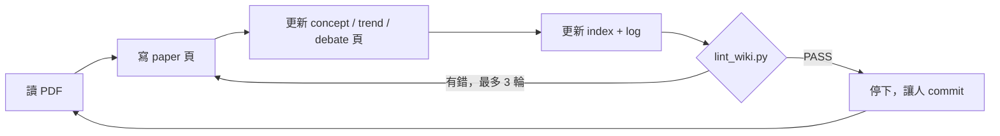
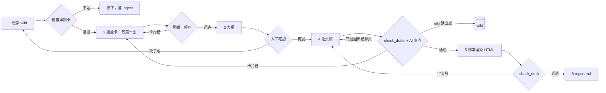

# 繳交內容

**繳交標題**：`<學校簡稱> <學號> <系級簡稱> <姓名> AI-Native 介面與 Agentic UX`

---

## 1. LLM Wiki 主題與簡短介紹

**主題：HCI：AI-Native 介面與 Agentic UX 設計趨勢**

依照 Karpathy 的 LLM Wiki 構想，把 5 篇 HCI 論文整理成由 agent 維護、互相連結的 Markdown 知識庫。涵蓋「經典準則 → 生成式 AI 介面 → Agent 介面」三個階段：

| 論文 | 角色 |
|---|---|
| Amershi et al., *Guidelines for Human-AI Interaction*（CHI 2019） | 18 條人機 AI 設計準則 |
| Subramonyam et al., *Bridging the Gulf of Envisioning*（CHI 2024） | prompt 介面的「想像鴻溝」 |
| Bansal et al., *Challenges in Human-Agent Communication*（MSR 2024） | 人與 agent 溝通的 12 個挑戰 |
| Feng et al., *Levels of Autonomy for AI Agents*（2025） | 五級自主性 |
| Mozannar et al., *Magentic-UI*（MSR 2025） | 人在迴路中 agent 的實作與評估 |

Wiki 共 23 頁：papers 5 頁、concepts 13 頁（每頁都有給新手的一句話定義）、trends 4 頁、debates 1 頁。每個論點都標到論文和 PDF 頁碼。規則由「先討論、後生成」的訪談產生（`AGENTS.md`，訪談紀錄見 `guide/interview-log.md`）。

## 2. LLM Wiki 連結

`https://github.com/<帳號>/<repo>/tree/main/wiki`（從 `wiki/index.md` 開始看）

## 3. 教學 HTML 簡報連結

`https://<帳號>.github.io/<repo>/ai-interface-shift.html`

「AI 介面正在發生什麼改變？從工具到 Agent 的設計趨勢」，共 14 頁。操作：← → 換頁、N 顯示講者備註、F 全螢幕。

教學結構：先備知識（Norman 的兩個鴻溝）→ 階段一：AI 會出錯 → 階段二：AI 會生成（想像鴻溝）→ 階段三：AI 會行動（溝通挑戰）→ 自主性五級 → 實例與數據（Magentic-UI）→ 討論題（人要監督多少）→ 總結。每頁頁尾都列出對應的 wiki 頁。

## 4. Loop / Graph 設計

### 第一段：wiki 建構 loop（每篇論文跑一次）

### 第二段：簡報 graph（`workflows/topic-slides.md`）

- **重複執行的步驟**：ingest 每篇一輪（lint 修正最多 3 輪）；節點 4「寫稿 → 檢查 → 修」最多 2 輪；整個 graph 最多 3 輪。
- **需要檢查或重新生成的地方**：每個節點後面都有一個腳本關卡；大綱需要人工確認；逐頁稿另外交給「新對話」的 AI 審查（作者不能審自己的作品）；錯在哪一關就退回哪一關，只重做出錯的那一頁或那一張卡。
- **為什麼這樣設計**：每個階段的品質標準不同，錯誤要在離源頭最近的地方修。渲染交給腳本、不經過 AI，所以排版時不可能偷改內容；每頁的出處列也是自動產生的，讓簡報和 wiki 一一對應。

## 5. 一次實際執行的結果與檢查紀錄

完整紀錄：`wiki/log.md`、`out/ai-interface-shift/report.md`、`out/ai-interface-shift/review.md`

| 階段 | 結果 |
|---|---|
| ingest amershi | lint 第 1 輪 FAIL（log 沒有紀錄；5 個定義句沒有出處）→ 修正後 PASS |
| ingest subramonyam | PASS，1 個警告（表格沒有出處）→ 加上出處欄 |
| ingest bansal | 第 1 輪就 PASS |
| ingest feng | PASS，1 個警告（爭論點那段沒有出處）→ 補上 |
| ingest mozannar | PASS |
| 人工檢查 | 2 處數字沒附頁碼、1 處 trend 段落沒有出處 → 補上 |
| 節點 1–3 | coverage PASS（16 頁、5 篇）、cards PASS（5 張）、outline 第 1 輪 FAIL（腳本 bug）→ PASS |
| 節點 4 | check_drafts 第 1 輪 PASS；作者自己比對發現 3 處忠實度問題，其中 1 處退回 wiki 補資料 |
| AI 審查第 1 輪 | **13 個問題**（9 個說得太滿、2 個缺出處、2 個覆蓋率），12 個退回節點 4、1 個退回 wiki |
| 修正後 | run_checks 全部 PASS（report.md） |

## 6. 反思

**哪個節點最常出錯？**
- wiki 層：一句話摘要和定義句最常漏掉出處。
- 簡報層：節點 4 的「說得太滿」。腳本全部通過的稿子，AI 審查仍然找到 13 個問題。

**如何調整檢查流程？**
- 把人工檢查前移進 `lint_wiki.py`：trends 段落的出處、新手定義、百分比的頁碼。
- 在 `check_drafts.py` 加入絕對化用詞警告，讓「說得太滿」在送審查之前就被抓到。
- 修正 `check_outline.py` 的 bug。
- 新增規則：跨頁歸納的結論要先在 wiki 寫成「綜合：…」，再放進簡報。

修改內容記錄在 `workflows/topic-slides.md` 的「修改紀錄」；完整反思見 `guide/reflection.md`。
