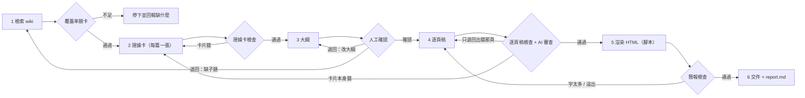

# Workflow：主題 → HTML 簡報（Graph 版）

用法：在 agent 對話框輸入
```
照 workflows/topic-slides.md 做簡報，主題：<主題>，slug：<英文短名>
```
例如：`主題：Agent 介面的自主性該怎麼設計，slug：agent-autonomy`

所有中間產物都放在 `out/<slug>/`。每一關的產出都能打開看、放進 git、單獨重跑。

## 流程圖



## 節點規格

每一關只能看「只能看」欄裡的檔案，只能寫「產出」欄裡的檔案。

| # | 節點 | 只能看 | 產出 | 不能做 | 關卡（腳本） |
|---|---|---|---|---|---|
| 1 | 檢索 | `wiki/index.md`、`wiki/` 底下的頁面 | `sources.md` | 讀 `raw/` 的 PDF、用 wiki 以外的知識 | `check_coverage.py` |
| 2 | 證據卡 | `sources.md`，加上**一篇**論文頁和它連到的概念頁 | `cards/<paper-id>.md` | 一張卡混入其他論文的內容 | `check_cards.py` |
| 3 | 大綱 | `sources.md`、`cards/` | `outline.md` | 寫完整內文 | `check_outline.py` → **人工確認** |
| 4 | 逐頁稿 | `outline.md`，加上這頁對應的卡片 | `drafts/slide-XX.md` | 引用卡片以外的內容 | `check_drafts.py` + AI 審查 |
| 5 | 渲染 | 已通過的 `drafts/` | `deck.html` | 改任何一個字（由腳本產生，不經 AI） | `check_deck.py` |
| 6 | 交件 | 所有關卡結果 | `report.md` | — | `run_checks.py` |

## 每個檔案的格式

### sources.md
```
# 主題：<主題>
## 相關頁面
- [[papers/<id>]] — 為什麼相關
- [[concepts/<name>]] — 為什麼相關
## 子題
- <子題 1>
- <子題 2>
```

### cards/<paper-id>.md
```
---
paper: <paper-id>
---
- <主張，用自己的話> [來源: papers/<paper-id> p.<頁碼或§章節>]
- ...
```
每張卡 3–8 條主張，全部只能來自同一篇論文。

### outline.md
```
# <簡報標題>
## slide 1: <標題>
cards: <paper-id>, <paper-id>
重點: <一句話>
## slide 2: ...
```
8–15 頁。第 1 頁是標題頁，最後一頁是總結或討論問題。

### drafts/slide-XX.md（XX 是兩位數）
```
---
slide: 3
title: <這頁標題>
layout: bullets        # title | bullets | compare | quote
sources: papers/feng2025-levels-of-autonomy, concepts/autonomy-levels
---
- 重點一
- 重點二
> notes: 講者備註（不會顯示在投影片上）
```
`compare` 版型用 `### 左欄標題`、`### 右欄標題` 分兩欄。

## 退回規則（錯在哪一關就退回哪一關）

| 狀況 | 退回到 | 怎麼修 |
|---|---|---|
| 覆蓋率不足（相關頁面少於 3，或論文少於 3 篇） | **停下** | 回報缺什麼，建議要再 ingest 哪幾篇 |
| 證據卡引用到別篇論文、頁碼缺漏 | 節點 2 | 只重做那一張卡 |
| 人看大綱發現少了子題 | 節點 1 | 補檢索，再更新卡片和大綱 |
| 某一頁沒有出處、數字對不上 | 節點 4 | 只修那一頁，其他頁不動 |
| AI 審查發現某頁講反了 | 節點 4（若卡片本身錯就回節點 2） | 只修那一頁或那張卡 |
| 字太多或溢出 | 節點 4 | 縮短那一頁，不准縮小字體 |

## 每一格裡面還是 loop
- 節點 4：寫一頁 → `check_drafts.py` → 修，**最多 2 輪**
- 節點 5：`render_deck.py` → `check_deck.py` → 回節點 4 修字數，**最多 2 輪**
- 整個 graph 最多從頭重跑 **3 輪**。超過就停下，把 `report.md` 交給使用者決定。

## AI 審查（節點 4 之後）
**開一個新的對話**，只給它 `drafts/` 和每頁引用到的 wiki 頁面，貼這段：
```
你是審查者，不是作者。逐頁檢查 out/<slug>/drafts/：
1. 忠實度：每個論點是否忠於所引用的 wiki 頁面？有沒有講反、誇大？
2. 覆蓋率：sources.md 列的論文有沒有被漏掉？
只輸出問題清單到 out/<slug>/review.md，格式：- slide-XX: <問題> | 建議退回節點 <2 或 4>
沒有問題就寫「全部通過」。不要自己動手修改任何檔案。
```

## 一鍵跑全部檢查
```
python scripts/run_checks.py <slug>
```
會依序跑所有關卡，結果寫進 `out/<slug>/report.md`。
